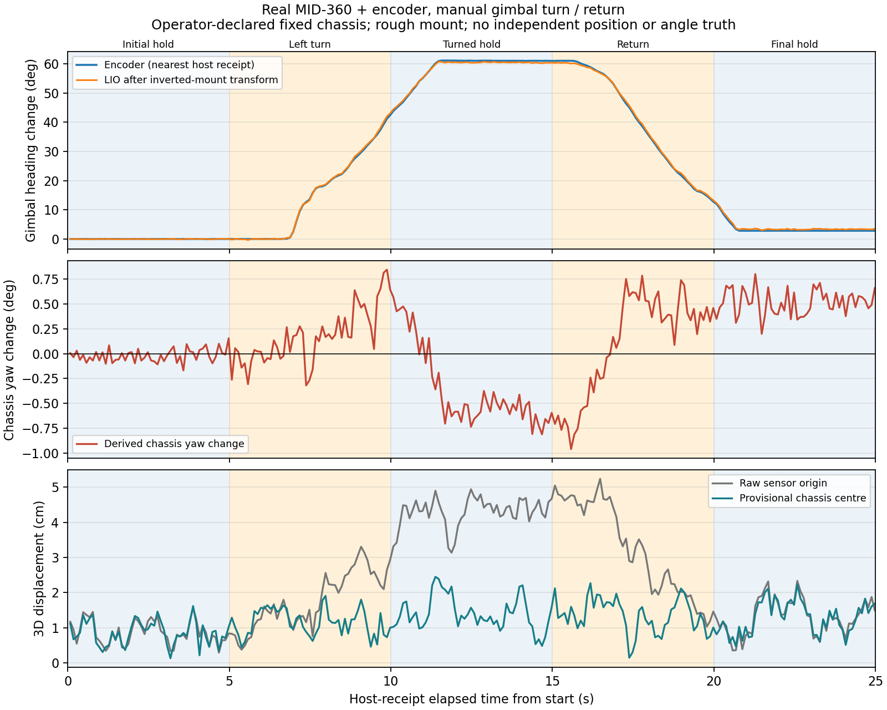

# 实机云台转动与底盘位姿补偿联合诊断（2026-10-18）

## 结论与范围

本轮实机采集、远端独立重算、原始文件传回及开发机独立重算均完成，三份判定一致。小电脑原报告与远端独立重算完全相同；跨机重算有4处报告数值末位差，最大约4.44e-16°，派生行角度差最大约5.10e-12°，因此派生JSONL字节哈希不同。原始字段、位置、时戳及文件哈希相同，差异明细保留在cross_machine_comparison.json，没有把不同派生哈希说成相同，也没有改变物理验收阈值。

记录完整且两路转出/返回实际覆盖；暂定几何及倒装变换下，约61°云台转动被抵消后，候选底盘朝向最大变化约0.96°，候选圆心3D最大采样位移约2.45 cm。未发明精度PASS阈值，仍为 `DIAGNOSTIC_COMPLETE_NO_ACCURACY_ACCEPTANCE`。

`compensation_accuracy_accepted=false`、`navigation_ready=false`。这不构成定位精度、底盘里程计接口、地图对齐或真实导航验收；不接入导航输出，不修改参数或安装尺寸，不重跑寻找成功。旧仿真与工具版本保留。

## 实机环境与执行

通过用户授权的SSH公钥连接rm@10.27.194.84。用户接好雷达供电/网线并在本地恢复192.168.1.5/24；192.168.1.173 ping三次成功。小电脑GitHub pull遇TLS中断，改为传输相同Git bundle并快进到精确提交 `0501242ccb04e7e2e1a70cb7436fc8c80417f5ca`；没有改网络设置或Git配置，也没有回滚历史文件。

小电脑18项新工具测试通过，sealed raw/phased输入148项核验通过。原始雷达和phased LIO在NoMachine桌面独立终端启动，ROS域43。采集前实际输入来源、QoS、新鲜度、内部IMU位姿输出及内部外参参数检查通过。

第三个终端等待操作者确认机械前向并按回车。自动阶段共25秒：baseline、turn_left、turned_hold、return、final_hold。操作者确认已完成；底盘不动/起始机械前向属于操作者声明，没有独立真值。没有导航、电机或新TF发布。

运行路径：`/home/rm/AeroMind_mid360_joint_checks/turn_return_20261018_152844/`。
启动与预检：`/home/rm/AeroMind_mid360_joint_checks/startup_20261018_152634/`。

## 核验结果

| 项目 | 结果 |
|---|---:|
| ROS消息收取/写入/实际行数 | 16186 / 16186 / 16186 |
| 有效CRC8408串口角度帧 | 5000，连续5000 |
| corrected / predicted / SI IMU 接收频率 | 约10 / 200 / 200 Hz |
| corrected最大接收/设备时间间隔 | 101.880 / 103.013 ms |
| 编码器最大接收间隔 | 5.384 ms |
| SI IMU最大接收间隔 | 6.642 ms |
| 任务corrected原始样本数 | 250 |
| 编码器向左/返回变化 | +61.0400° / −58.2275° |
| LIO云台向左/返回变化 | +60.4604° / −57.0867° |
| 编码器回原位差 | +2.8125° |
| 补偿后底盘yaw最大绝对采样变化 | 0.9614° |
| 补偿后底盘完整3D旋转最大采样变化 | 1.0120° |
| 转后/返回后底盘yaw中位数 | −0.5774° / +0.5713° |
| 原始传感器3D最大采样位移 | 5.2396 cm |
| 暂定圆心3D最大采样位移 | 2.4478 cm |
| 转后圆心位移 / 返回圆心闭合差 | 1.1414 / 0.9535 cm |
| 最近主机接收时刻配对最大差 | 2.2054 ms |
| 写盘溢出、错误 | 0，无 |

底盘yaw相对初始静止窗口姿态均值计算；baseline中位数约+0.0102°，因此返回相对baseline中位数的变化约+0.5611°。表中2.8125°是手动回位的编码器读数差，没有真值，不能归因为编码器测量误差。

mixed_legacy报告257次时间回退，属于原先预测/校正混合输出的已知诊断语义。corrected、predicted、TF和IMU无时间回退；混合身份多重集合与两路并集相同，TF与corrected原始位姿匹配，所有任务窗口覆盖满足既有连续性规则。未把mixed旧流作为导航位姿输入或隐去它的回退。

## 残差与不能下的结论

暂定圆心最大位移发生在任务约11.381 s，处于转后保持阶段，坐标变化主要为LIO局部X。最大yaw残差约−0.9614°发生在15.579 s（返回阶段开始附近）。它们不是同一个时刻，不能将全部位置残差用单个yaw峰值解释。

安装面前偏25 mm和高度550 mm是粗测；本轮未重新测量或拟合。位置预览使用固定IMU→同轴圆心杆臂；编码器仅用于抵消朝向，不把圆心钉在初始位置。高度杆臂可将roll/pitch估计或实际安装变化耦合为位置变化；现有数据不足以将剩余位移唯一归因于LIO、外参、支架形变或手动扰动。

2.2054 ms为同一电脑的接收时刻配对差，不能证明设备时钟同步或真实采样时刻接近。LIO计算时延、传输时延和编码器采样时间未知；没有做时延拟合或插值来降低残差。初始前向编码角约0.01917476 rad仅为本轮候选，没有写回全局零位配置。

当前只有一次联合手动试验，没有统计重复性结论或连续时间误差界；所有位移为sensor-local LIO坐标中的3D估计量，无真实位置/角度参考。不能据“最大采样变化2.45 cm”宣称真实定位精度2.45 cm，也不能据此判断省赛通行安全。



## 原始证据与复核入口

小电脑保留全部 `native.jsonl`、encoder原始字节/读取记录、输入快照、manifest、哈希、两份审计及派生行。传回完整归档SHA256：`fb6e405c367702a29f576f3b3813ac8fd8d3b7b0ec14effe56cecbf847ac8034`。

开发机保留：`tools/results/real_mid360_joint_20261018_152844/turn_return_20261018_152844/`。
Windows备份：`artifacts/real_mid360_joint_20261018_152844.tar.gz`。
原始文件所有记录哈希在远端和本地独立审计时重新核对；未将大份原始串口/CDR文件发布进Git。

复核（指定新的输出名，原报告保留）：
```bash
cd ~/AeroMind_20261016
MID360_ROS_DOMAIN_ID=43 bash tools/hardware/mid360_lio_phased/env.sh \
  python3 -B tools/hardware/mid360_joint_check/review.py \
  /home/rm/AeroMind_mid360_joint_checks/turn_return_20261018_152844 \
  --output-name independent_joint_review_v2.json
```

本次发布的是报告、紧凑溯源和图；工具、雷达、LIO与导航输出逻辑均未修改。没有自动重新试验。

## 最小下一步

先进行有地面距离参考的短距离手推平移检查：云台相对底盘保持机械前向，底盘朝向保持一致，测量起终点并单次推去/返回，验证坐标方向、尺度和实际平移仍被保留。需要独立的真实距离记录和适配此动作的只读记录模式；当前转云台工具的“必须发生5°转动”判据不能直接用于平移试验。

不因这次联合诊断通过直接启用真实电机闭环。仍需尺寸复测、时间关联/陈旧数据行为、地图坐标关系及底盘速度协议的后续验证。训练场与正式省赛场地验收状态不因本轮改变。
