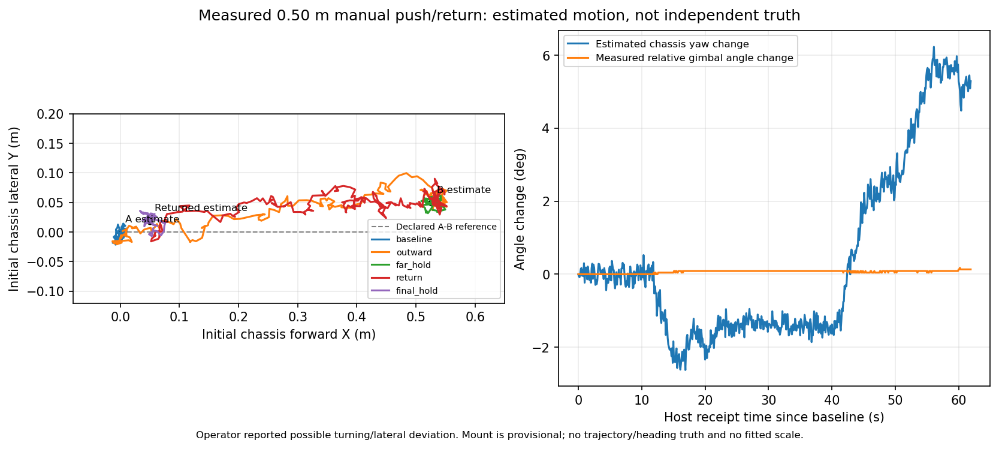

# MID-360 0.50米手推往返核验（2026-10-18 16:44）

**本轮核验完成：记录完整、定位健康检查通过，未复现公里级发散；距离精度尚不验收。**

| 项目 | 结果 |
|---|---:|
| A→B卷尺参考 | 0.5000m |
| 前进方向估计位移 | 0.5265m |
| 与参考差值 | +2.65cm |
| 返回段前进轴位移 | -0.4767m |
| 回A后的三维估计闭合差 | 5.32cm |
| B点横向估计偏移 | 4.93cm |
| 全程最大估计底盘朝向变化 | 6.23° |
| 云台相对底盘角度最大变化 | 0.176° |

用户已补充：**手推时可能有转向或侧偏**。因此横向偏移、朝向变化和闭合差不能全部归因于定位误差；同一底盘标记的端点对齐及实际朝向没有独立跟踪。观测到的1.053比例只作为本次结果记录，不用于修改尺度、外参或融合权重。

原始ROS消息44,362条，收到、写入、实际行数完全相等，无队列溢出或写盘错误。校正LIO约9.999Hz，最大接收间隔0.1115s，零时间戳重复/倒退。预测约200.003Hz。电控39字节CRC8408回包有效，接收器没有发送串口数据。5秒起点、B点和回A静止窗口均通过本轮工程健康检查。

试验期间守卫原始接收账本截取14,786条（704条点云检查、14,082条IMU检查），无故障。该账本不是完整点云CDR，不据此声称已经独立验证每次点云匹配或发布端零丢包。

小电脑独立复核与采集summary完全一致；另一台机器再次独立复算的判定也一致。具体数值/派生文件哈希比较保留在cross_machine_comparison_v1.json，没有覆盖原始证据。81项工具输入的快照、当前路径和哈希均匹配。

## 下一步

在平整地面用边线或直尺辅助保持直行，保持底盘和云台原朝向，用同一个固定标记严格对齐A/B，再完成受控往返对照。先确认可重复的误差，再判断是否需要调整定位；本轮不根据一个可能转向的样本改算法，也不以此作为实车自动导航验收。

## 证据

小电脑：
/home/rm/AeroMind_mid360_translation_checks/push_return_20261018_164408/

诊断补充：
/home/rm/AeroMind_mid360_translation_checks/review_20261018_164408/

本地完整包：real_mid360_translation_20261018_164408.tar.gz
SHA256：7a6e085765201b30eb064616da44f68e4038813ff11ce5ed0ba4069d83d5b5e3

